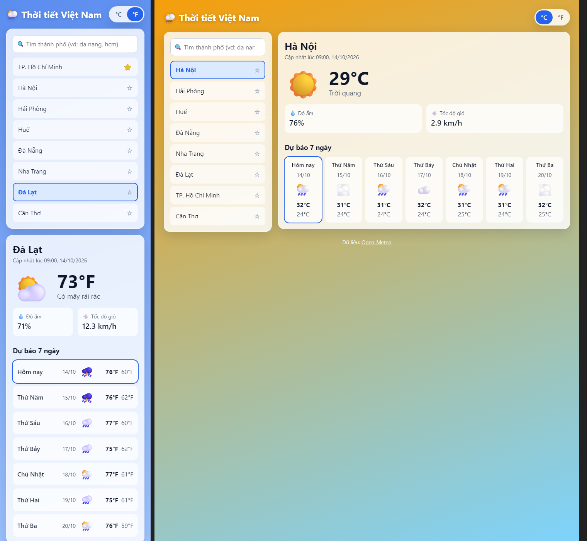

# Thời tiết Việt Nam — Bài TH02

Ứng dụng React xem thời tiết hiện tại và dự báo 7 ngày của 8 thành phố Việt Nam, dữ liệu từ API [Open-Meteo](https://open-meteo.com/en/docs) (miễn phí, không cần API key).



## Công nghệ

- Vite + React 19 + TypeScript (strict, không dùng `any`)
- CSS thuần (1 file `src/index.css` chia theo mục), không dùng thư viện UI
- Gọi API bằng `fetch`, dựng URL bằng `URLSearchParams`
- Lint bằng oxlint

## Cách chạy

```bash
npm install
npm run dev      # mở http://localhost:5173
npm run build    # kiểm tra kiểu + build production
npm run lint
```

## Yêu cầu đã làm

| Mục | Nội dung | Cách làm |
| --- | --- | --- |
| YC1 | Danh sách 8 thành phố, làm nổi bật thành phố đang chọn | Nền + viền xanh, chữ đậm, `aria-pressed` |
| YC2 | Thời tiết hiện tại | Emoji, mô tả tiếng Việt, nhiệt độ, độ ẩm, gió, "Cập nhật lúc 09:00, 14/10/2026" |
| YC3 | Dự báo 7 ngày | Thứ ("Hôm nay", Thứ Hai… Chủ Nhật), dd/mm, emoji, cao/thấp; ngày parse theo giờ địa phương |
| YC4 | Trạng thái chưa chọn / đang tải / lỗi / thành công | Spinner + skeleton; lỗi có nút **Thử lại** gọi lại đúng thành phố; kiểm tra `response.ok` và lỗi mạng; `AbortController` hủy request cũ |
| YC5 | Đổi °C / °F | Dữ liệu gốc lưu ở °C, chỉ đổi khi hiển thị, không gọi lại API |
| YC6 | Responsive | ≥ 768px: 2 cột; < 768px: xếp dọc; không cuộn ngang (đã thử ở 320px) |

**Nâng cao**

- Tìm thành phố không phân biệt dấu/hoa thường: `da nang`, `ha noi`, `hanoi`, `hcm`, `sai gon`…; báo khi không có kết quả.
- Thành phố yêu thích (⭐) lưu `localStorage` (có `try/catch`), hiển thị lên đầu danh sách.
- Nền gradient đổi theo nhóm thời tiết (quang, mây, sương mù, mưa phùn, mưa, tuyết, dông) với hiệu ứng chuyển mượt (`@property`).
- Toàn bộ viết bằng TypeScript.

## Cấu trúc

```
src/
  types/weather.ts        interface response Open-Meteo + dữ liệu đã chuẩn hóa
  data/cities.ts          8 thành phố (id, name, lat, lon) + tên tắt để tìm kiếm
  api/openMeteo.ts        fetchWeather(city, signal)
  utils/weatherCode.ts    bảng mã WMO → mô tả, emoji, nhóm thời tiết
  utils/format.ts         đổi °C/°F, định dạng thứ/ngày/giờ cập nhật
  utils/normalize.ts      bỏ dấu tiếng Việt
  hooks/useWeather.ts     trạng thái idle | loading | error | success
  hooks/useFavorites.ts   thành phố yêu thích + localStorage
  components/             CityList, SearchBox, CurrentWeather, Forecast, UnitToggle, StatusView
  App.tsx, index.css
```
