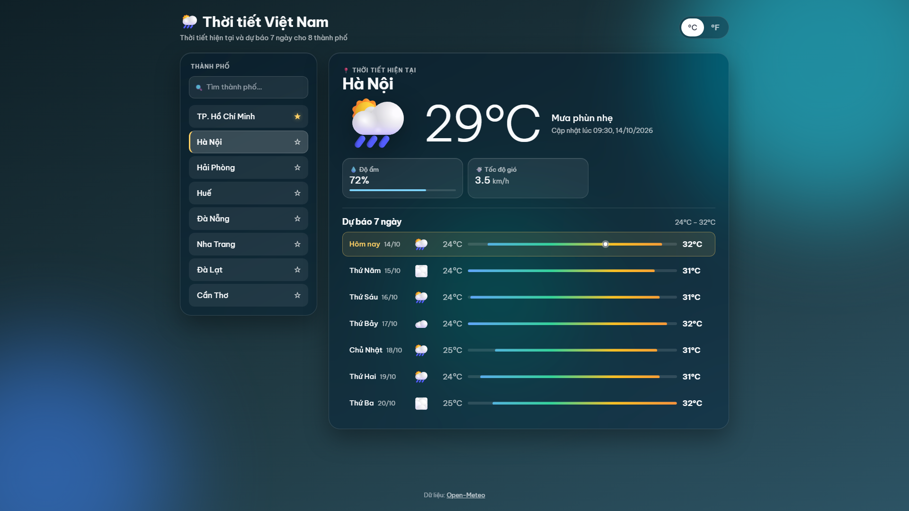
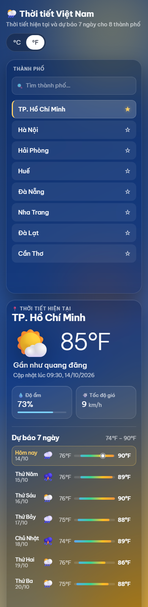

# Thời tiết Việt Nam — Bài TH02

Ứng dụng React xem thời tiết hiện tại và dự báo 7 ngày của 8 thành phố Việt Nam, dữ liệu từ API [Open-Meteo](https://open-meteo.com/en/docs) (miễn phí, không cần API key).

| Desktop (1920×1080, vừa 1 màn hình) | Mobile (390px) |
| --- | --- |
|  |  |

## Công nghệ

- Vite + React 19 + TypeScript (strict, không dùng `any`)
- CSS thuần (1 file `src/index.css` chia theo mục), không dùng thư viện UI; font Be Vietnam Pro (Google Fonts)
- Gọi API bằng `fetch`, dựng URL bằng `URLSearchParams`
- Lint bằng oxlint

## Cách chạy

```bash
npm install
npm run dev      # mở http://localhost:5173
npm run build    # kiểm tra kiểu + build production
npm run lint
```

## Yêu cầu đã làm

| Mục | Nội dung | Cách làm |
| --- | --- | --- |
| YC1 | Danh sách 8 thành phố, làm nổi bật thành phố đang chọn | Nền sáng hơn, viền trái màu nhấn `#ffd166`, chữ 600, `aria-pressed` |
| YC2 | Thời tiết hiện tại | Emoji lớn cạnh số nhiệt độ, mô tả tiếng Việt, "Cập nhật lúc 09:00, 14/10/2026"; 2 chip Độ ẩm (kèm thanh %) và Tốc độ gió |
| YC3 | Dự báo 7 ngày | Mỗi ngày 1 hàng: thứ ("Hôm nay", Thứ Hai… Chủ Nhật) + dd/mm, emoji, thấp, thanh dải nhiệt độ, cao; ngày parse theo giờ địa phương |
| YC4 | Trạng thái chưa chọn / đang tải / lỗi / thành công | Spinner + skeleton; lỗi có nút **Thử lại** gọi lại đúng thành phố; kiểm tra `response.ok` và lỗi mạng; `AbortController` hủy request cũ |
| YC5 | Đổi °C / °F | Dữ liệu gốc lưu ở °C, chỉ đổi khi hiển thị, không gọi lại API |
| YC6 | Responsive | ≥ 768px: 2 cột; < 768px: xếp dọc; không cuộn ngang (đã thử 320–390px); 1920×1080 vừa 1 màn hình |

**Nâng cao**

- Tìm thành phố không phân biệt dấu/hoa thường: `da nang`, `ha noi`, `hanoi`, `hcm`, `sai gon`…; báo khi không có kết quả.
- Thành phố yêu thích (⭐) lưu `localStorage` (có `try/catch`), hiển thị lên đầu danh sách.
- Giao diện glassmorphism tông đậm: nền gradient đổi theo nhóm thời tiết (quang, mây, sương mù, mưa, tuyết, dông) kèm các vòng tròn mờ trang trí, chuyển màu mượt bằng `@property`.
- Thanh dải nhiệt độ trong dự báo: vị trí đầu/cuối tính theo min/max của **cả tuần** nên nhìn là thấy xu hướng; gradient xanh → cam theo nhiệt độ thực; hàng "Hôm nay" có chấm trắng đánh dấu nhiệt độ hiện tại.
- Phân cấp chữ rõ ràng: chỉ tên thành phố, tiêu đề mục và nhiệt độ cao nhất in đậm; chữ phụ mờ hơn; số nhiệt độ hero nét mảnh.
- Toàn bộ viết bằng TypeScript.

## Cấu trúc

```
src/
  types/weather.ts        interface response Open-Meteo + dữ liệu đã chuẩn hóa
  data/cities.ts          8 thành phố (id, name, lat, lon) + tên tắt để tìm kiếm
  api/openMeteo.ts        fetchWeather(city, signal)
  utils/weatherCode.ts    bảng mã WMO → mô tả, emoji, nhóm thời tiết
  utils/format.ts         đổi °C/°F, định dạng thứ/ngày/giờ cập nhật
  utils/normalize.ts      bỏ dấu tiếng Việt
  hooks/useWeather.ts     trạng thái idle | loading | error | success
  hooks/useFavorites.ts   thành phố yêu thích + localStorage
  components/             CityList, SearchBox, CurrentWeather, Forecast, UnitToggle, StatusView
  App.tsx, index.css
```
